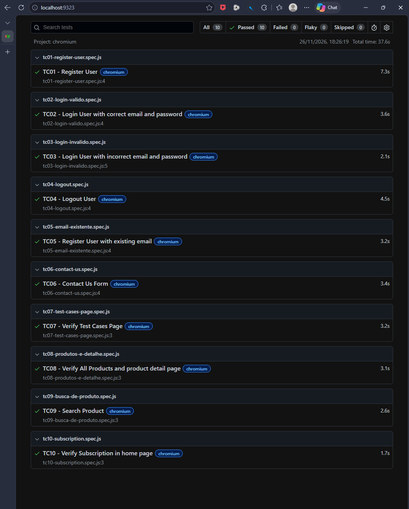

# Resultado da execução

- Data: 26/11/2026, 18:26:19 (horário de Fortaleza)
- Navegador: Chromium
- Aprovados: 10
- Falhas: 0
- Instáveis: 0

| Caso de teste | Resultado | Duração | Evidência |
|---|---|---|---|
| TC01 - Register User | Aprovado | 7,3 s | [print](prints/TC01.png) |
| TC02 - Login User with correct email and password | Aprovado | 3,6 s | [print](prints/TC02.png) |
| TC03 - Login User with incorrect email and password | Aprovado | 2,1 s | [print](prints/TC03.png) |
| TC04 - Logout User | Aprovado | 4,5 s | [print](prints/TC04.png) |
| TC05 - Register User with existing email | Aprovado | 3,2 s | [print](prints/TC05.png) |
| TC06 - Contact Us Form | Aprovado | 3,4 s | [print](prints/TC06.png) |
| TC07 - Verify Test Cases Page | Aprovado | 3,2 s | [print](prints/TC07.png) |
| TC08 - Verify All Products and product detail page | Aprovado | 3,1 s | [print](prints/TC08.png) |
| TC09 - Search Product | Aprovado | 2,6 s | [print](prints/TC09.png) |
| TC10 - Verify Subscription in home page | Aprovado | 1,7 s | [print](prints/TC10.png) |

O relatório HTML completo está em `relatorio-html/index.html`. Baixe o repositório e abra o arquivo no navegador.

## Print da execução

